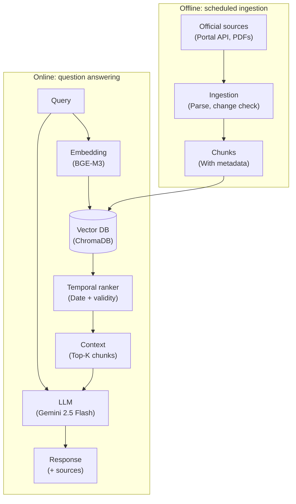
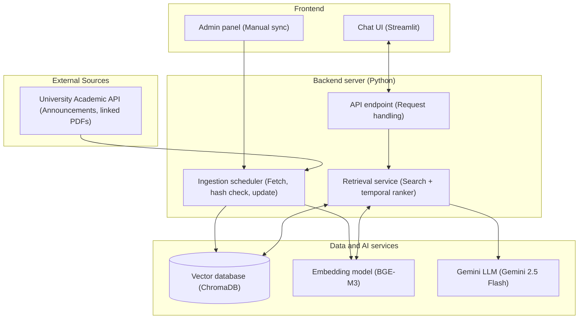
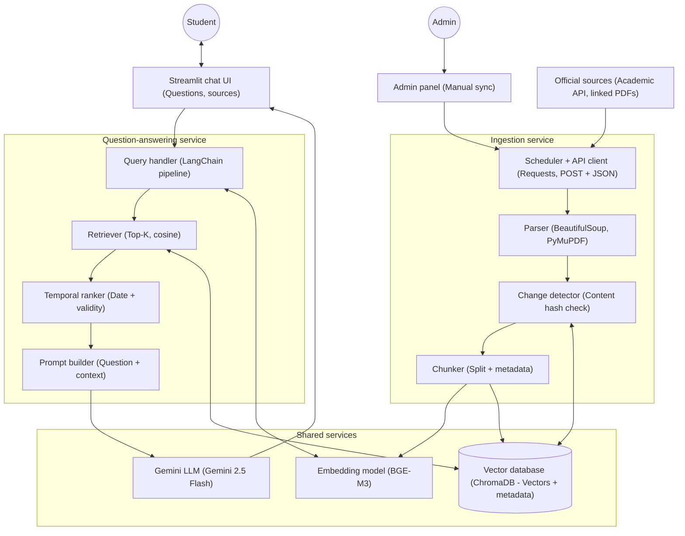
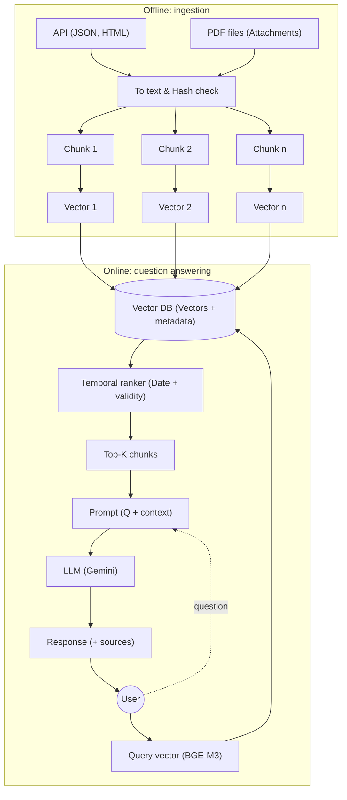
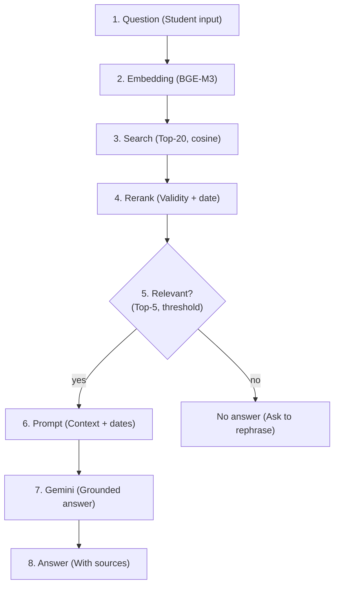
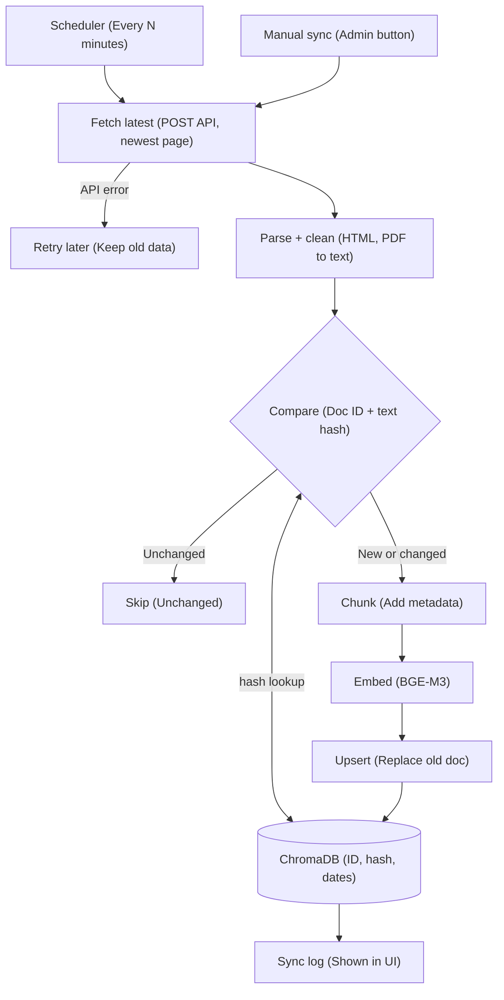

# HANOI UNIVERSITY
## FACULTY OF INFORMATION TECHNOLOGY

---
### MIDTERM REPORT
# University AI Assistant

**COURSE NAME:** Advanced Topics in Information Technology (ATI)  
**Semester:** Fall - 2026  

**Group Members:**
1. **Đinh Thị Hải** — 2301040058
2. **Đinh Thị Khuê** — 2301040092
3. **Nguyễn Minh Nguyệt** — 2301040142

**Lecturer:** Bùi Minh Đức

---

## 1. Overview

### 1.1 General Overview
**University AI Assistant** is an AI-powered chatbot designed to help students and lecturers quickly access official university information through natural language questions.

Instead of searching through multiple websites or lengthy PDF documents, users can ask questions such as:
- *"What is the tuition fee for Semester 1?"*
- *"What are the graduation requirements for Computer Science?"*
- *"How can I register for a retake course?"*
- *"Where can I find the curriculum for my major?"*

The assistant retrieves relevant information from official university documents and generates accurate responses with references to the source documents.

The system is built using the **Retrieval-Augmented Generation (RAG)** architecture, which combines a Large Language Model (LLM) with a vector database. In addition to retrieving relevant information from university documents, the system includes an automated data ingestion pipeline that periodically checks official university sources for new or updated announcements and documents.

The data ingestion component collects announcement data from the university's official Academic Management portal through its HTTP API, when supported by the endpoint's access rules and request parameters. Retrieved content is processed, checked for changes, divided into chunks, and stored in a vector database. Temporal-aware retrieval considers semantic relevance, publication dates, and document validity periods so that answers can reflect the appropriate version of university information.

The system aims to provide students with convenient, up-to-date, and source-grounded answers while reducing the need to search manually through multiple university documents and announcements.

#### Expected Benefits
- **Faster access to university information.**
- **Reduced time spent searching through documents.**
- **Reliable answers grounded in official university resources.**
- **Easy-to-use conversational interface for students.**
- **Automatically updated university knowledge base** that reflects newly published or modified official information.
- **Improved handling of outdated documents and multiple document versions.**
- **Near real-time availability:** Ensure that any new or updated university announcement becomes answerable by the chatbot within one polling interval plus processing time, subject to source availability and API access constraints.

### 1.2 Target Audience
- **Primary users (Students):** Need quick access to academic regulations, tuition deadlines, retake exam procedures, and graduation requirements without navigating complex university portals.
- **Secondary users (Lecturers/Advisors):** Require quick references to official guidelines to support and advise students accurately.

### 1.3 Project Scope & Limitations
- **In-scope:** The system strictly handles and retrieves public, shared academic knowledge (e.g., official announcements, student handbooks, general regulations) fetched from the university's public API.
- **Out-of-scope:** The system **DOES NOT** access, process, or store personal student data (e.g., individual grades, private schedules, financial status). This ensures strict data privacy and eliminates the need for user authentication in the current 8-week timeframe.
- The `/sync` endpoint and the Admin panel are protected by a simple admin key.

---

## 2. Problems and Objectives

### 2.1 Problems
Students often encounter the following challenges when searching for university information:

| Problem | Description |
| :--- | :--- |
| **Scattered Information Sources** | University regulations, curriculum documents, tuition fee information, schedules, and study materials are distributed across multiple websites and PDF files. |
| **Time-Consuming Search** | Students need to read long documents to locate the required information. |
| **Outdated or Confusing Documents** | Multiple versions of university regulations, tuition policies, and announcements may exist. Without proper version and validity management, the system may retrieve outdated or conflicting information. |
| **Limited Keyword-Based Search** | Traditional university websites only support keyword matching and cannot understand natural language questions. |
| **Manual Knowledge Base Maintenance** | Newly published announcements and updated documents may not be reflected in the chatbot immediately if the knowledge base relies on manual updates. |

### 2.2 Objectives
- Develop an AI chatbot capable of answering university-related questions accurately using official university documents.
- Collect and organize official university documents.
- Build a vector database for efficient document retrieval.
- Implement a Retrieval-Augmented Generation (RAG) pipeline.
- Develop a chatbot interface for natural language interaction.
- Display supporting document sources in responses.
- Implement an automated data ingestion pipeline to periodically detect new or updated content from official university sources.
- Track document metadata, including publication dates, last-updated dates, effective dates, validity periods, and source URLs when available.
- Implement temporal-aware document ranking that combines semantic relevance with freshness and document validity.
- Detect duplicate or modified documents to keep the knowledge base consistent and reduce unnecessary reprocessing.

#### Expected Outcomes
- Accurate answers for frequently asked university questions.
- Response time within a few seconds.
- A scalable system that can easily incorporate new university documents.

---

## 3. Technical Approaches

### 3.1 Proposed Technology Stack

| Component | Technology / Tool |
| :--- | :--- |
| **Frontend** | Streamlit |
| **Programming language** | Python |
| **LLM** | Gemini API |
| **Embedding** | BAAI/bge-m3 |
| **Vector Database** | ChromaDB |
| **RAG Framework** | LangChain |
| **Document Parsing** | PyMuPDF |
| **Data Ingestion** | Requests and BeautifulSoup |
| **Backend & Scheduling** | FastAPI (RESTful API backend) and APScheduler (background task scheduling) |

### 3.2 Proposed Solution

#### Step 1: Automated Data Ingestion
The system will use Python and the `requests` library to communicate with the university's Academic Management API through HTTP POST requests.

The ingestion pipeline will:
1. Send a POST request using the required JSON payload.
2. Parse the JSON response and extract announcement metadata and HTML content.
3. Convert HTML into clean text while preserving important tables, links, and document structure.
4. Extract links to related PDF documents for separate processing when appropriate.
5. Calculate a content hash to detect whether an announcement has changed.
6. Store new or updated documents and refresh their corresponding vector representations.

This ingestion process runs periodically (e.g., every 15-30 minutes) via an APScheduler background task, and can also be triggered manually by administrators to ensure near real-time synchronization.

#### Step 2: Data Preprocessing
HTML content will be processed using `BeautifulSoup`, while PDF documents will be extracted using `PyMuPDF`. Each document will be stored separately. Long documents will be split into smaller chunks for retrieval, with metadata attached to each chunk.

#### Step 3: Retrieval-Augmented Generation
The RAG pipeline consists of:
1. Converting source documents into text chunks.
2. Generating vector embeddings with BGE-M3.
3. Storing vectors and metadata in ChromaDB.
4. Retrieving relevant chunks for a user's question.
5. Passing the retrieved context to the Gemini API.
6. Generating an answer grounded in retrieved sources and presenting source references.

#### Step 4: Temporal-Aware Retrieval & Re-ranking
Instead of relying solely on semantic similarity, the retrieval process is strictly bound by time through three phases:
1. **Semantic Search:** The user query is embedded, and ChromaDB retrieves the Top-K most relevant document chunks based on Cosine Similarity.
2. **Validity Filtering (Check Metadata):** The system inspects the metadata (stored in ChromaDB) of the retrieved chunks. If the algorithm detects chunks with an `expiration_date` older than the current time, they are immediately filtered out to prevent outdated answers.
3. **Recency Re-ranking:** For the remaining valid chunks, a boost score is applied based on the `publication_date`. Newer documents are given higher weights. The Top-N chunks with the highest combined score are selected as the final context for the Gemini LLM.

#### Step 5: Answer Generation
The retrieved context is combined with the user's question and sent to the Gemini model. The LLM generates an answer strictly based on the retrieved context, reducing hallucination.

### 3.3 Algorithms and Methods

| Method / Algorithm | Purpose |
| :--- | :--- |
| **Text Chunking** | Split long documents into manageable semantic chunks. |
| **Embedding (BGE-M3)** | Convert text into vector representations. |
| **Cosine Similarity** | Measure similarity between user queries and document vectors. |
| **Top-K Retrieval** | Select the most relevant document chunks. |
| **Prompt Engineering** | Guide Gemini to answer using retrieved context only. |
| **Temporal-Aware Ranking** | Combine semantic relevance with freshness and validity. |

### 3.4 Trade-offs

| Option | Advantages | Disadvantages |
| :--- | :--- | :--- |
| **ChromaDB** | Free, lightweight, easy to update and run locally. | Slightly slower than FAISS on very large datasets. |
| **FAISS** | Very fast retrieval performance. | Less convenient for dynamic document updates. |
| **Gemini API** | High-quality responses, free tier available, easy integration. | Requires an internet connection and API quota. |
| **Local LLM (Llama)** | Runs offline and keeps all data locally. | Requires significant computing resources. |

#### Selected Solution
The team chose the **Gemini 2.5 Flash API** as the Large Language Model, **BGE-M3** for text embeddings, **ChromaDB** as the vector database, and **LangChain** to orchestrate the RAG pipeline. This combination is highly effective, free for academic development, and perfectly suited for the project scope.

#### Polling Interval vs. System Resources
A short polling interval ensures the knowledge base is highly up-to-date but consumes more API requests and computing power, risking rate limits. A longer interval saves resources but increases the delay in answering new announcements. We balance this by setting a **15-30 minute interval** with a manual **"Sync Now"** fallback.

---

## 4. System Design

The system consists of two main pipelines:
- **Data Ingestion Pipeline** – periodically collects and processes announcements from the university's official API.
- **Question-Answering Pipeline** – retrieves relevant information and generates answers for student questions.

Both pipelines share a common knowledge base stored in ChromaDB.

### 4.1 Architecture Description

The system consists of eight main modules:

| Module | Function |
| :--- | :--- |
| **User Interface** | Chat for students and an admin panel (Sync Now, sync log). |
| **Backend Service (FastAPI)** | Exposes `/chat`, `/sync` and `/status`, coordinates the RAG and ingestion pipelines, and separates the UI from database logic. |
| **Retriever** | Searches ChromaDB for relevant document chunks. |
| **Temporal Ranker** | Re-ranks retrieved chunks based on temporal relevance and validity. |
| **Vector Database** | Stores document embeddings and metadata. |
| **Gemini LLM** | Generates final answers using retrieved context. |
| **Ingestion Service** | Periodically fetches announcements, parses content, detects changes via hash, and chunks data. |
| **Embedding Model (BGE-M3)** | Converts both document chunks and user queries into dense vectors. |

### 4.2 Data Flow Diagram

#### Data Flow Steps
1. The scheduler (or the Admin's "Sync Now" button) triggers the ingestion service.
2. The API client fetches the newest announcements and their linked PDFs.
3. HTML and PDF content is parsed and converted to clean text.
4. The content hash (SHA-256) is compared with the stored value; unchanged documents are skipped.
5. New or modified documents are split into chunks with attached metadata.
6. Chunks are embedded using BGE-M3.
7. Vectors and metadata are upserted into ChromaDB, replacing any previous versions.
8. A student submits a question via the UI, which is embedded with BGE-M3.
9. ChromaDB returns the Top-20 chunks; expired chunks are filtered out, and the remainder are re-ranked by recency.
10. The Top-5 chunks and the query form a prompt for Gemini.
11. Gemini generates a grounded answer, returned to the user with source references.

### 4.3 Inference Flow Chart

#### Inference Process
1. Receive the user question.
2. Generate the question embedding with BGE-M3.
3. Search ChromaDB and retrieve the Top-20 chunks by cosine similarity.
4. Remove expired chunks and re-rank the rest by similarity and recency; keep the Top-5.
5. Check relevance threshold: If no chunk reaches the minimum similarity threshold, return a *"No information found"* fallback message.
6. Construct a prompt containing the question, retrieved context, and dates.
7. Send the prompt to Gemini to generate the answer.
8. Return the answer and supporting sources.

### 4.4 Knowledge Base Update Mechanism (Near Real-time)

The knowledge base is kept up to date by an automatic, incremental synchronization process. A scheduler wakes up every $N$ minutes and requests the newest announcements from the university’s Academic Management API. An administrator can also trigger the same process manually from the interface using a "Sync Now" button.

For every fetched announcement, the content is parsed into clean text, and its document ID and content hash are compared with the values stored in ChromaDB. Unchanged announcements are skipped to save resources. New or modified announcements are chunked with updated metadata, embedded with BGE-M3 and upserted into ChromaDB, so the chatbot reflects them without a system restart.

If the University API is unavailable, the system keeps answering from the existing knowledge base and retries in the next cycle. Each sync run is written to a sync log (timestamp, new/modified/skipped counts, errors) exposed via FastAPI to the Admin panel. Therefore, a new announcement becomes answerable within one polling interval plus processing time.

---

## 5. Development Plan

| Week | Task | Expected Deliverable |
| :--- | :--- | :--- |
| **Week 1-2** | Analyze University API structure, implement Python scripts for API requests, and parse HTML/PDF into clean text. | API endpoint list, raw data structure, and clean text files. |
| **Week 3-4** | Setup local ChromaDB, implement text chunking, attach metadata (Dates, IDs), and generate embeddings using BGE-M3. Build the basic RAG pipeline. | Vector database successfully populated; Basic RAG pipeline functioning via terminal. |
| **Week 5** | Implement incremental updates (Hash check) and integrate the automated Scheduler for continuous data ingestion. | Background script that automatically fetches and updates only new/modified documents. |
| **Week 6** | Develop Temporal-Aware Retrieval logic (metadata filtering for expiration dates and recency re-ranking). | Chatbot answers strictly bound by time and validity metrics. |
| **Week 7** | Build Chat UI using Streamlit, including an Admin panel with a "Manual Sync" button and update logs. | Fully functional Chat UI and Admin control panel. |
| **Week 8** | Conduct full system testing (testing insert/update/skip scenarios), optimize prompts, and prepare the final presentation. | Finalized product, presentation slides, and evaluation metrics. |

---

## 6. Current Progress

| System Component | Status | Details / Next Steps |
| :--- | :--- | :--- |
| **Data Ingestion (Core)** | Completed (100%) | Automated API connection, HTML/PDF parsing, and text extraction are fully working. |
| **Vector DB & Chunking** | Completed (100%) | Local ChromaDB is successfully populated. Text chunking and Metadata attachment (Dates, IDs) are done. |
| **Basic RAG Pipeline** | In Progress (70%) | Working via terminal. Currently optimizing prompt engineering to minimize AI hallucinations. |
| **Incremental Updates** | In Progress (30%) | Writing Hash comparison logic. Next step: Integrate the automated Scheduler. |
| **Temporal-Aware Logic** | Not Started (0%) | Next step: Implement metadata filtering and recency scoring. |
| **User Interface (UI)** | Not Started (0%) | Next step: Build Streamlit chat interface and Admin sync panel. |

---

## 7. AI Disclosure

This project applies an AI-assisted development methodology. While all final architectural decisions, logic verification, and testing are performed by human members, AI tools were utilized to accelerate development and troubleshoot issues:

| Project Component | Human Role & Decision | AI Tool & Its Role | Verification Method |
| :--- | :--- | :--- | :--- |
| **System Architecture** | Team defines data flows and finalizes the overall architecture (separating UI from Backend). | Suggests architectural options and refines system diagrams. | Cross-checked against academic requirements. |
| **Backend & Ingestion** | Khuê and Nguyệt design the polling rules and document hashing logic. | Generates Python boilerplate for API requests, routing, and parsing. | Manual testing and monitoring sync logs. |
| **RAG & Retrieval** | Hải and Khuê outline the semantic and temporal ranking mechanisms. | Provides LangChain and ChromaDB syntax guidelines. | Evaluated against a predefined test set of frequent questions. |
| **UI & Quality Assurance** | Hải and Nguyệt design the UI layout, set up test scenarios, and review final answers. | Generates UI components and helps analyze error tracebacks for debugging. | End-to-End manual testing and bug-fixing. |
